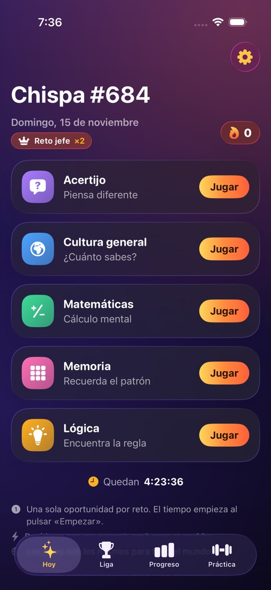
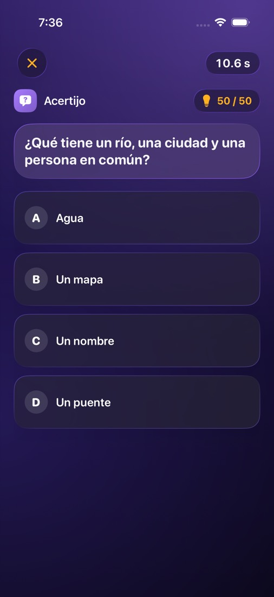
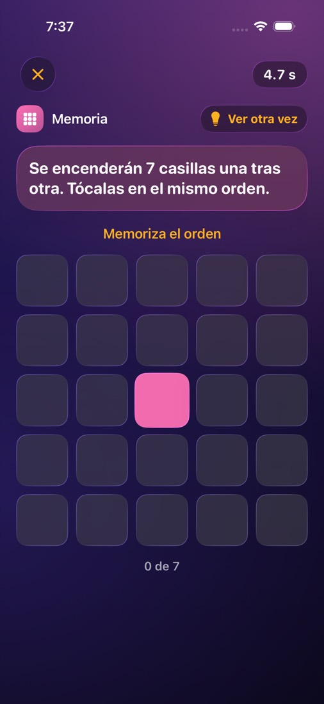
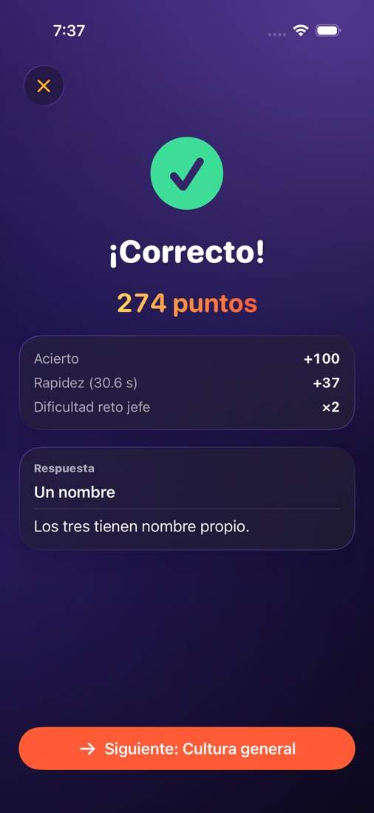
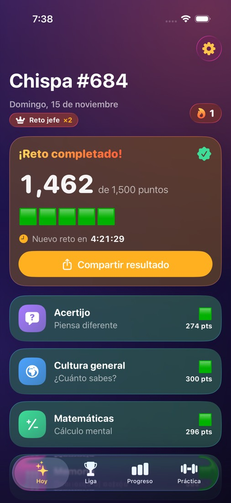
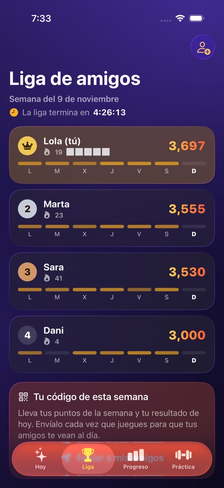
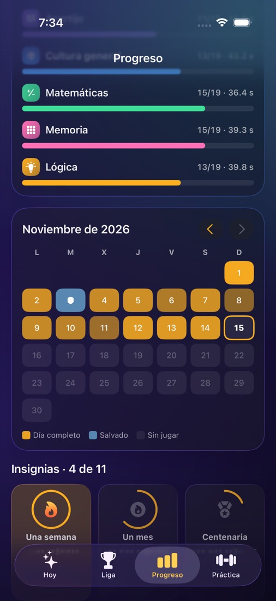
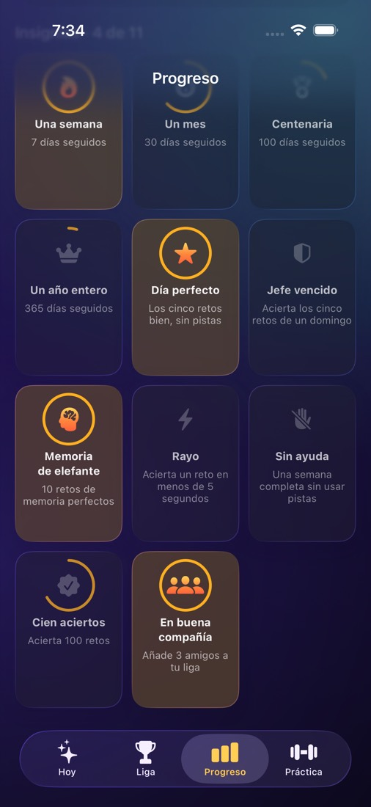

# Chispa

El reto diario: cinco retos nuevos cada día, los mismos para todo el mundo, con una sola oportunidad.

| Hoy | Reto | Memoria | Resultado | Día completo | Liga | Calendario | Insignias |
|---|---|---|---|---|---|---|---|
|  |  |  |  |  |  |  |  |

## Qué incluye
- **Cinco retos al día**: acertijo, cultura general, matemáticas, memoria y lógica.
- **Contenido**: 366 acertijos y 388 preguntas de cultura escritos a mano (un año sin repetir). Matemáticas,
  memoria y lógica se generan solos a partir de la fecha, así que nunca se acaban.
- **Dificultad semanal**: lunes y martes fácil (×1), miércoles y jueves media (×1,25), viernes y sábado difícil (×1,5)
  y el domingo **reto jefe** (×2).
- **Puntos**: 100 por acierto, hasta +50 por rapidez y −30 por usar ayuda (50/50, pista o ver otra vez).
- **Una oportunidad**: el tiempo empieza al pulsar «Empezar» y sigue corriendo aunque salgas de la app.
- **Rachas** con **protectores** (uno cada 7 días, máximo 2) e **insignias**.
- **Liga de amigos sin servidor**: compartes un código firmado por WhatsApp y tu amigo lo pega en la app.
- **Estadísticas**: aciertos por tipo, punto fuerte y punto flojo, tiempos y calendario.
- **Práctica** con los retos de los últimos 30 días, **recordatorio diario** y **widget** con la cuenta atrás.

## Proyecto
- `ChispaKit/`: días, generadores, contenido, puntuación, rachas y códigos (compartido con el widget).
- `Chispa/`: la app (SwiftUI, Liquid Glass, SwiftData).
- `ChispaWidget/`: el widget.
- Tests: 23 de lógica (contenido, niveles, puntos, rachas, códigos y partida) y 3 recorridos completos por la interfaz con capturas.

Todo se guarda solo en el iPhone. El ranking mundial con Game Center está preparado pero desactivado:
necesita publicar la app con una cuenta de desarrollador de Apple.
