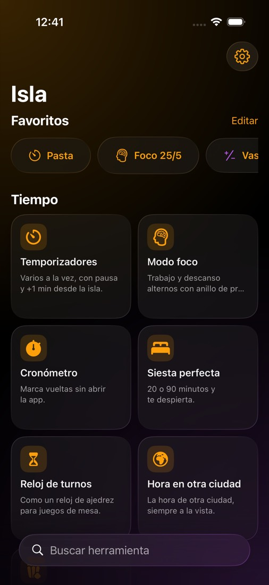
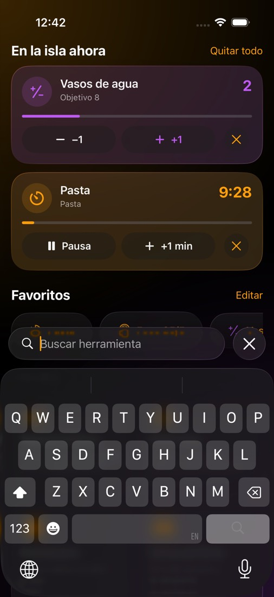
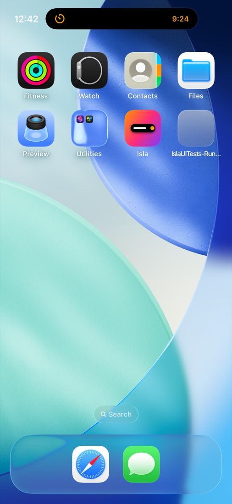
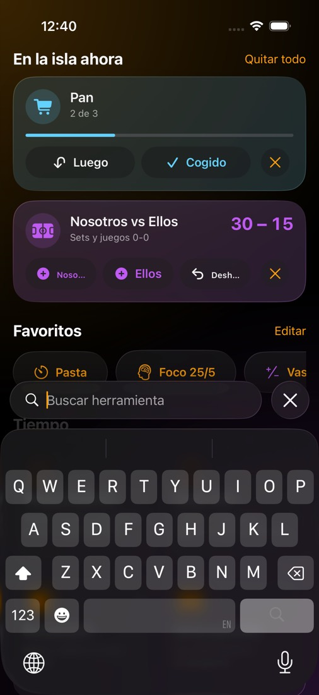
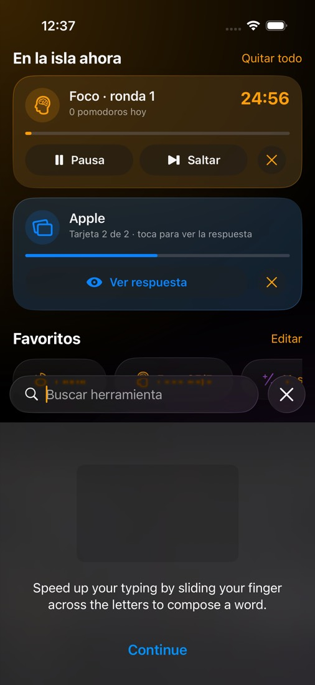

# Isla

30 herramientas para la Isla Dinámica, con botones que funcionan desde la propia isla y la pantalla de bloqueo.

| Inicio | En marcha | La isla | Marcador y lista | Foco y tarjetas |
|---|---|---|---|---|
|  |  |  |  |  |

- **Tiempo:** temporizadores, modo foco, cronómetro, siesta, reloj de turnos, hora en otra ciudad, peli o serie.
- **Movimiento:** avísame en mi parada, volver al coche, velocidad y distancia, ticket de aparcamiento, vuelo o tren.
- **Casa:** lista de la compra, receta paso a paso, electrodomésticos, cargando, post-it.
- **Salud:** pastilla o rutina, ayuno, respiración, entreno por series, desde la última vez.
- **Ocio:** marcador (pádel y tenis con 15-30-40), árbitro, contador, gasto.
- **Trabajo y estudio:** tarea fija, tarjetas de estudio, próxima cita, presentación.

Favoritos, Siri («temporizador en Isla», «modo foco en Isla») y controles para el Centro de Control y el botón de Acción.
El iPhone decide cuántas actividades enseña a la vez en la isla. La isla real se ve mejor en un iPhone físico.

Proyecto: `IslaKit/` (lo que comparten app y extensión), `Isla/` (app y motor de las herramientas),
`IslaWidget/` (vistas de la isla y la pantalla de bloqueo, controles). Tests de lógica y 4 recorridos con capturas.
