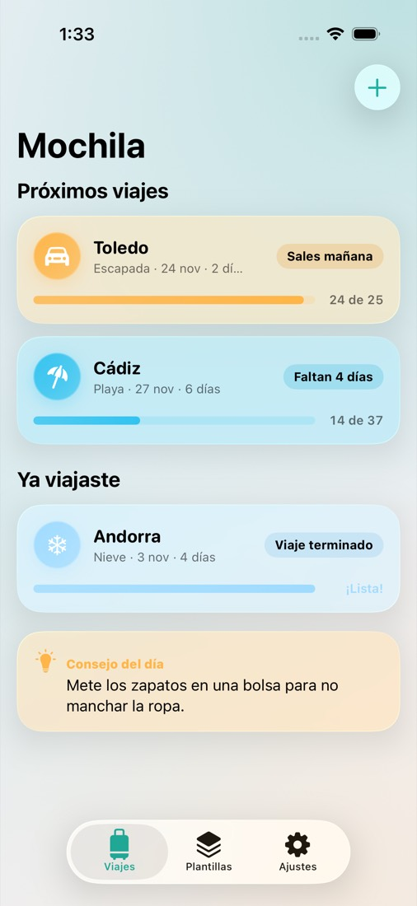
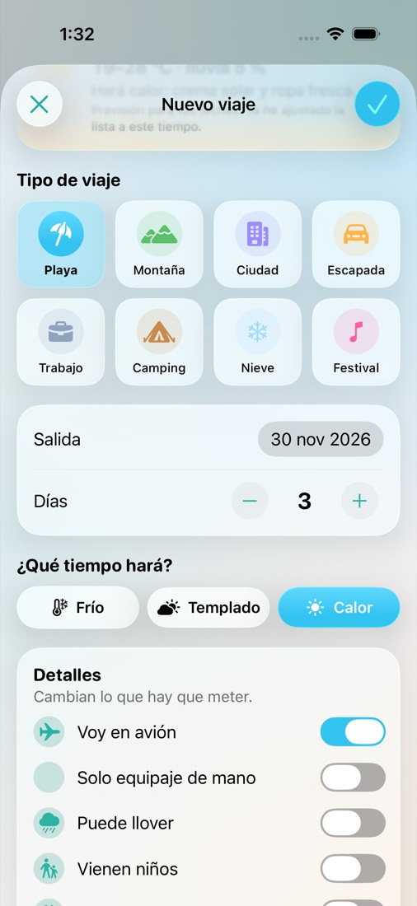
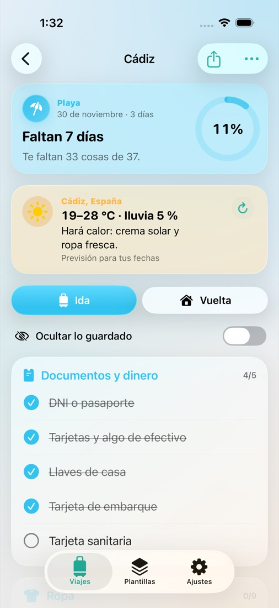
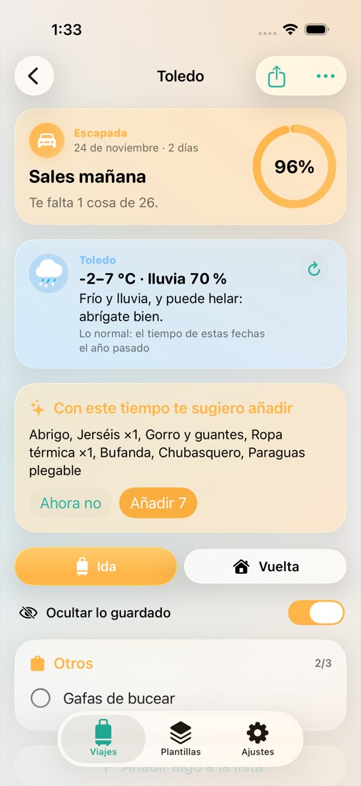
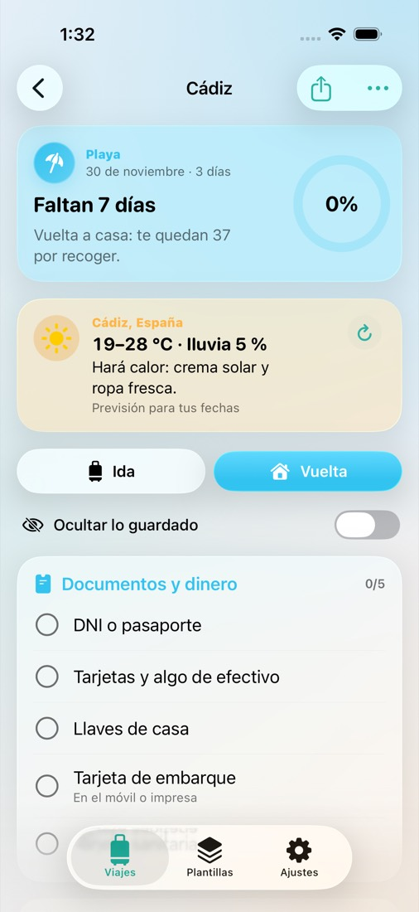
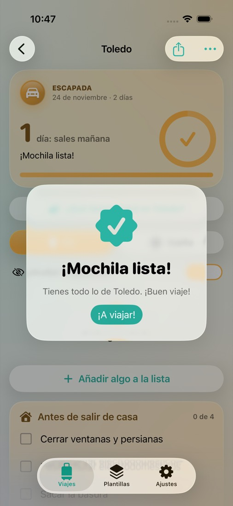
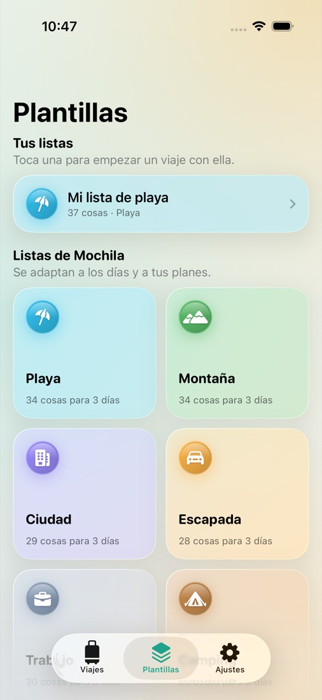

# Mochila

Listas para hacer la maleta sin olvidar nada: según el tipo de viaje, los días y tus planes.

| Viajes | Nuevo viaje | La lista | El tiempo | Ida y vuelta | ¡Lista! | Plantillas |
|---|---|---|---|---|---|---|
|  |  |  |  |  |  |  |

## Qué incluye
- **8 tipos de viaje**: playa, montaña, ciudad, escapada, trabajo, camping, nieve y festival.
- **El tiempo del destino**: escribes a dónde vas y la app consulta el tiempo para tus fechas (Open-Meteo, gratis y sin
  cuenta): previsión real si el viaje es en los próximos 16 días y, si es más adelante, el tiempo de esas fechas el año
  pasado. Ajusta la lista sola (frío, calor, lluvia, heladas) y, si cambia, te sugiere lo que falta.
- **Lista a medida**: según los días (cantidades calculadas: «Camisetas ×5»), el tiempo (frío, templado, calor, lluvia),
  si vas en avión o solo con equipaje de mano (aviso de líquidos de 100 ml), si vienen niños o mascota y si tendrás lavadora.
- **Antes de salir de casa**: cerrar ventanas, desenchufar, sacar la basura, check-in online…
- **Ida y vuelta**: al volver, repasa la misma lista para que no se quede nada en el hotel.
- **Progreso** con anillo y barra, «ocultar lo guardado», búsqueda y celebración al completar la mochila.
- **Tus cosas**: añade lo que quieras, guarda la lista como plantilla y duplica viajes.
- **Compartir** la lista como texto (WhatsApp, Notas…).
- **Recordatorio** la víspera del viaje con lo que te falta.
- **Widget** con un consejo de viaje al día que abre un viaje nuevo.

## Proyecto
- `MochilaKit/`: tipos de viaje, catálogo, generador de listas, cuenta atrás y consejos (compartido con el widget).
- `Mochila/`: la app (SwiftUI, Liquid Glass, SwiftData).
- `MochilaWidget/`: el widget.
- Tests: lógica (todas las combinaciones de viaje) y dos recorridos completos por la interfaz con capturas.

Todo se guarda solo en el iPhone, sin cuentas.
