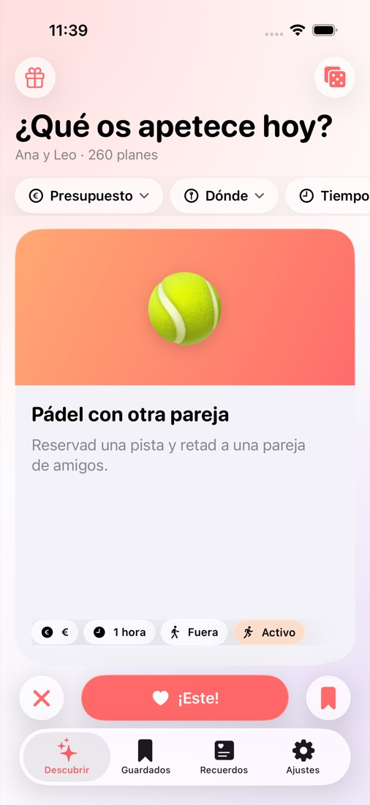
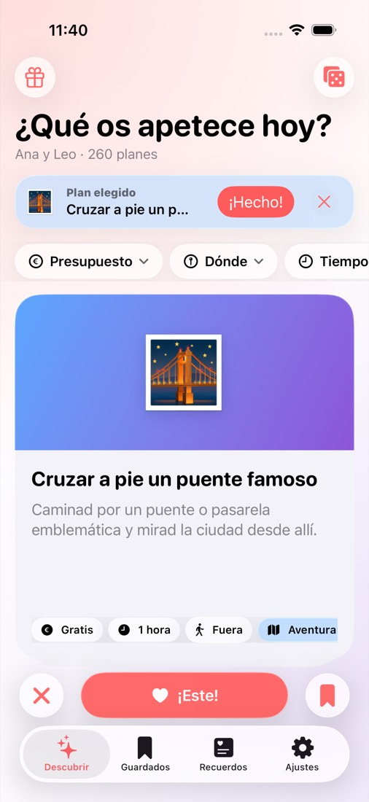
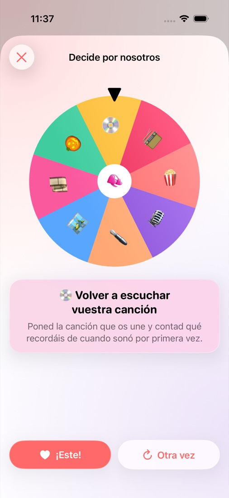
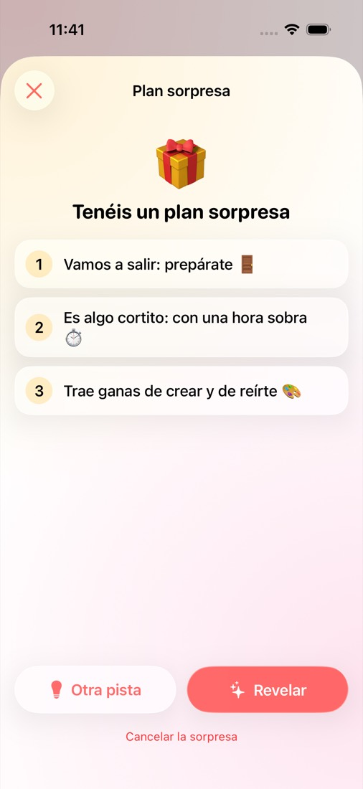
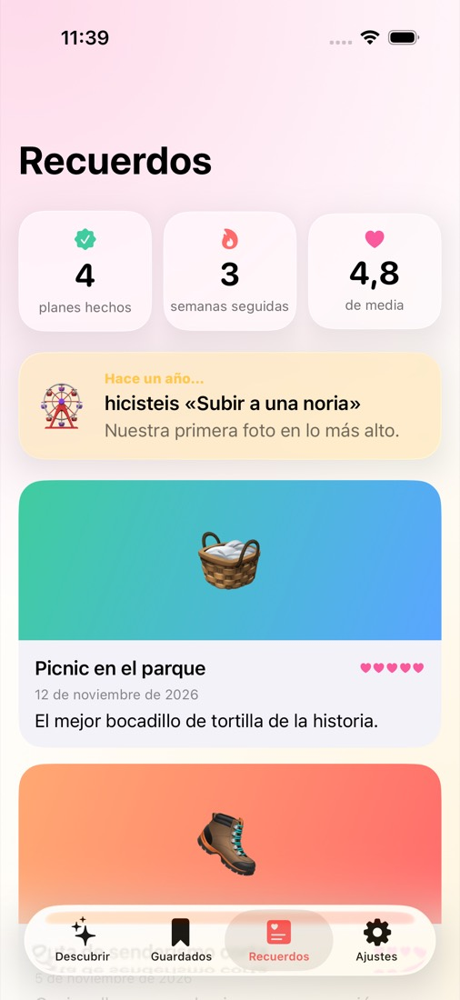
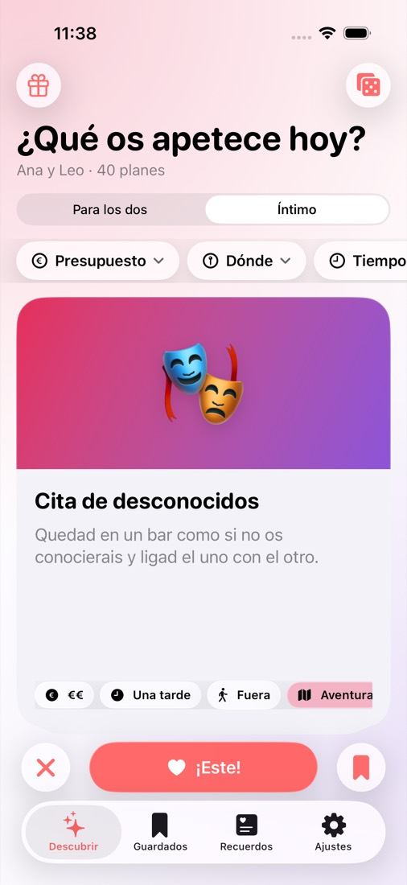

# Plan B

Planes para pareja para cuando no sabéis qué hacer. 300 ideas con filtros, una baraja que se desliza,
ruleta, plan sorpresa con pistas y un diario de vuestras citas.

| Descubrir | Plan elegido | Ruleta | Sorpresa | Recuerdos | Íntimo |
|---|---|---|---|---|---|
|  |  |  |  |  |  |

## Qué incluye
- **300 planes** (tranquilos, románticos, activos, de aventura, creativos y 40 del apartado íntimo), con coste,
  duración, lo que necesitáis y un truco para hacerlos especiales.
- **Filtros**: presupuesto, en casa o fuera, tiempo disponible, momento del día y ambiente.
- **Baraja**: desliza a la derecha para guardar, a la izquierda para pasar, «¡Este!» para elegir.
- **Decide por nosotros**: ruleta con 8 planes que cumplen los filtros.
- **Plan sorpresa**: uno elige en secreto, el otro recibe pistas hasta revelarlo.
- **Recuerdos**: fecha, corazones, nota y foto; planes hechos, racha semanal, media y «hace un año…».
- **Vuestros planes**, recordatorio semanal de noche de cita y apartado **íntimo (+18)**, que solo se activa
  si los dos lo confirmáis.
- **Widget «Plan del día»** (pequeño y mediano); al tocarlo abre ese plan.

## Proyecto
- `PlanBKit/`: planes, filtros, baraja, pistas y estadísticas, compartido con el widget.
- `PlanB/`: la app (SwiftUI, Liquid Glass, SwiftData).
- `PlanBWidget/`: el widget.
- Tests: 22 de lógica y 5 recorridos completos por la interfaz con capturas.

Todo se guarda solo en el iPhone.
