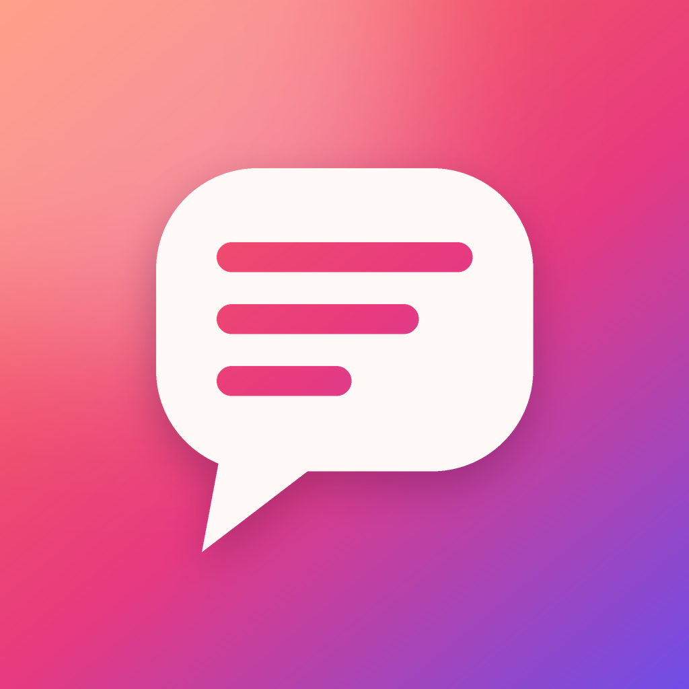

# Relato — estudio de historias para vídeo vertical



**Relato** es una app nativa para iPhone pensada para quienes cuentan historias en TikTok, Reels y Shorts
(*storytime*, terror, misterio, true crime, humor…). Reúne en una sola herramienta las tres cosas que
deciden si una historia funciona:

1. **El gancho.** Los primeros 3 segundos deciden si deslizan. Relato puntúa tu gancho mientras escribes.
2. **El tiempo.** Escribes por bloques narrativos y ves la duración hablada real, segundo a segundo.
3. **La grabación.** Un teleprompter junto a la cámara frontal que avanza **al ritmo al que hablas**.

## Funcionalidades

| Área | Qué hace |
|---|---|
| **Biblioteca** | Historias con estado (borrador → lista → grabada → publicada), búsqueda en títulos y guiones, filtros, fijar arriba, duplicar, racha de días grabando y tomas de los últimos 7 días. |
| **Plantillas** | 6 estructuras probadas (Storytime clásico, Misterio sin resolver, Terror en 60 s, Lección personal, POV/Confesión, En blanco). Cada bloque trae su propia indicación de escritura. |
| **Editor por bloques** | Gancho, contexto, tensión, giro, desenlace, cierre y bloque libre. Puedes reordenarlos, cambiarles el tipo o eliminarlos. Duración por bloque y total frente al objetivo, con una barra de tiempo de colores. Sugiere «Marcar como lista» cuando el guion está completo y cabe en el tiempo. |
| **Coach de gancho** | Puntuación de 0 a 100 con consejos concretos: duración (< 3 s), saludos que restan, preguntas, datos concretos, si hablas a quien mira y palabras de tensión. |
| **Dividir en partes** | Corta historias largas en *Parte 1, 2, 3…* según la duración máxima. Avisa si un corte no deja *cliffhanger* y permite copiar o compartir cada parte. |
| **Teleprompter** | Modo ensayo y modo grabación. La velocidad se calcula a partir de tus palabras por minuto y se reparte por bloque; puedes ajustarla de 0,5× a 2×. Muestra el bloque que estás leyendo, marca la línea de lectura y permite arrastrar para moverte por el texto, tocar para pausar, cuenta atrás de 3 s y texto en espejo. La pantalla no se apaga mientras lo usas. |
| **Grabación** | Cámara frontal a 1080p en vertical, con micrófono si das permiso. Cada toma queda guardada con su historia, con miniatura y duración. Desde la revisión puedes reproducirla, guardarla en Fotos, compartirla o eliminarla. |
| **Ideas** | Captura rápida. Desliza para convertir una idea en historia: la idea pasa a ser el gancho y se sugiere un título. |
| **Ajustes** | Velocidad al hablar (110–210 ppm), duración por defecto, tamaño de texto, cuenta atrás, espejo, vibraciones, recordatorio diario con notificación local, ejemplos, volver a ver la introducción y borrar todo. |

## Tecnología

- **Swift 6** con concurrencia estricta, **SwiftUI** y **SwiftData**. Sin dependencias externas.
- **iOS 26+** con **Liquid Glass** nativo (`glassEffect`, `GlassEffectContainer`, `.glass` / `.glassProminent`).
  El cristal se usa solo en la capa de controles flotantes; el contenido va sobre superficies sólidas, como pide la HIG.
- **AVFoundation** (captura y grabación), **AVKit** (reproducción), **Photos** (guardar con permiso de solo añadir),
  **UserNotifications** (recordatorio diario).
- Modo claro y oscuro, Dynamic Type, etiquetas de VoiceOver, «Reducir movimiento» y vibraciones que se pueden desactivar.

### Arquitectura

```
Relato/
├── App/            Punto de entrada, SwiftData (con recuperación si el almacén se corrompe), navegación, preferencias
├── Models/         @Model Story · Beat · Take · Idea  +  enums (BeatKind, StoryGenre, StoryStatus)
├── Core/           Motores puros y testeables, sin UI:
│                   ScriptMetrics · HookAnalyzer · PartSplitter · PrompterPacing · StreakCalculator · ScriptExporter
├── Services/       Cámara (cola propia), almacenamiento de tomas, Fotos, notificaciones, acciones sobre modelos, ejemplos
├── DesignSystem/   Paleta adaptable, componentes (tarjetas, chips, barra de tiempo, anillo de puntuación…), hápticos
└── Features/       Onboarding · Library · Templates · Editor · Prompter · Ideas · Settings
RelatoTests/        Tests unitarios (Swift Testing): motores y modelos
RelatoUITests/      Flujos de extremo a extremo en claro y oscuro con capturas, más una medición del arranque
```

### Decisiones de rendimiento

- **Teleprompter a la frecuencia nativa (hasta 120 Hz).** `PrompterEngine` solo guarda un punto de partida
  (tiempo transcurrido y fecha de inicio). La posición se calcula en cada fotograma dentro de `TimelineView(.animation)`
  sin modificar ningún estado. La columna de texto es `Equatable`, así que su `body` no se recalcula mientras avanza:
  solo cambia cuando pasas de bloque o cambias el tamaño de letra.
- **La cámara nunca bloquea el hilo principal.** Toda la configuración, el arranque y la parada de `AVCaptureSession`
  se hacen en una cola serie propia.
- **Fondo estático.** Es un `MeshGradient` sin animación: no gasta GPU ni batería por fotograma.
- **Miniaturas** generadas en segundo plano y guardadas en un `NSCache` con límite.
- **Listas perezosas** (`List` / `LazyHStack`); los cálculos sobre el guion son lineales y muy baratos.

## Cómo ejecutarlo

### En el simulador
1. Abre `Relato.xcodeproj` con **Xcode 26** o posterior.
2. Elige el esquema **Relato** y un simulador de iPhone con iOS 26.
3. Pulsa **⌘R**. La cámara no existe en el simulador: el modo grabación lo detecta y ofrece «Ensayar sin grabar».

### En tu iPhone
1. Conecta el iPhone (iOS 26 o posterior) y, si te lo pide, activa **Ajustes › Privacidad y seguridad › Modo desarrollador**.
2. En Xcode: selecciona el proyecto → target **Relato** → **Signing & Capabilities**.
   - **Team:** tu Apple ID (vale una cuenta gratuita, añadiéndola en *Xcode › Settings › Accounts*).
   - **Bundle Identifier:** cámbialo por uno único, por ejemplo `com.tunombre.relato`
     (`app.relato.studio` puede estar ocupado).
3. Elige tu iPhone como destino y pulsa **⌘R**.
4. Con una cuenta gratuita, la primera vez ve a **Ajustes › General › VPN y gestión de dispositivos** y confía en tu certificado.
   (Con cuenta gratuita la app caduca a los 7 días; vuelve a ejecutarla desde Xcode para renovarla.)

No necesitas claves de API, backend ni servicios externos: todo funciona sin conexión y los datos se quedan en el iPhone.

### Tests
- En Xcode: **⌘U** (pasa los tests unitarios y los de interfaz).
- Por terminal:
  ```bash
  xcodebuild test -project Relato.xcodeproj -scheme Relato \
    -destination "platform=iOS Simulator,name=iPhone 17 Pro"
  ```
- **CI:** `.github/workflows/ios.yml` compila y pasa todos los tests en macOS 26 con Xcode 26.6 en cada push,
  y publica las capturas de los tests de interfaz como *artifact*.

## Permisos que pide la app
| Permiso | Cuándo | Para qué |
|---|---|---|
| Cámara | Al abrir «Grabar» | Grabar la toma con la cámara frontal |
| Micrófono | Al abrir «Grabar» | Grabar tu voz (si lo deniegas, se graba sin audio) |
| Fotos (solo añadir) | Al pulsar «Guardar» en una toma | Guardar el vídeo en tu carrete |
| Notificaciones | Al activar el recordatorio diario | Aviso local a la hora que elijas |

## Hoja de ruta (ideas siguientes)
- Widget de racha y de la próxima historia que toca grabar (WidgetKit).
- Sincronizar entre dispositivos con CloudKit (los modelos ya son compatibles).
- Medir tu velocidad real de habla con Speech y recalibrar las palabras por minuto automáticamente.
- Subtítulos automáticos al exportar.
