# Ronda — juegos para la previa

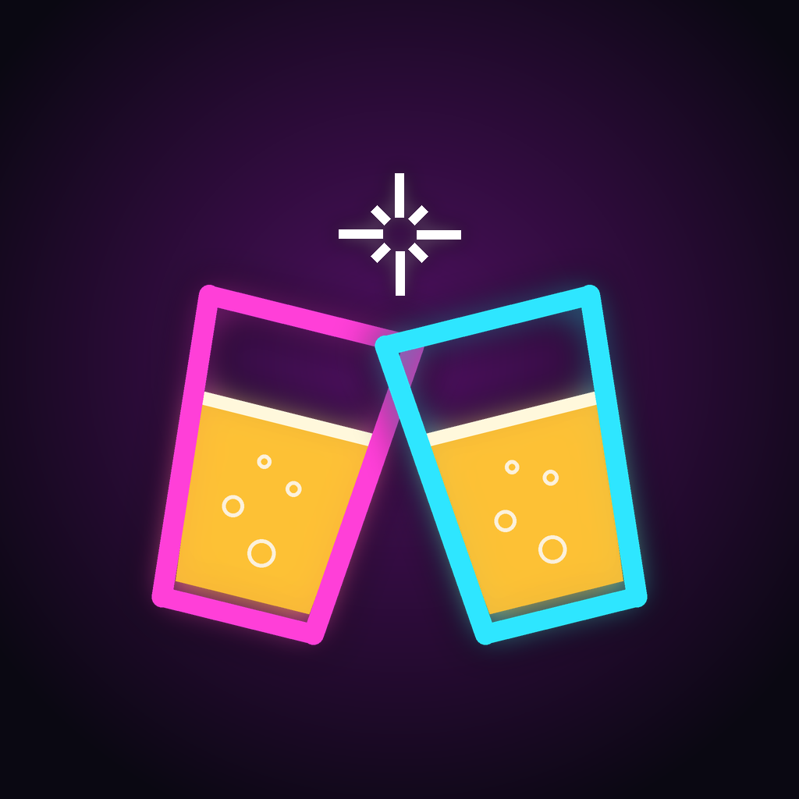

Un solo móvil en la mesa: metéis los nombres una vez y saltáis de un juego a otro durante la noche.
Sin internet, sin cuentas y sin anuncios.

  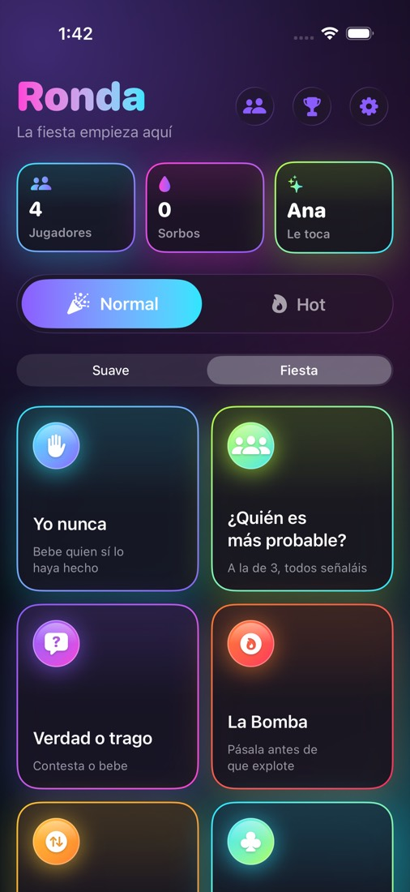
  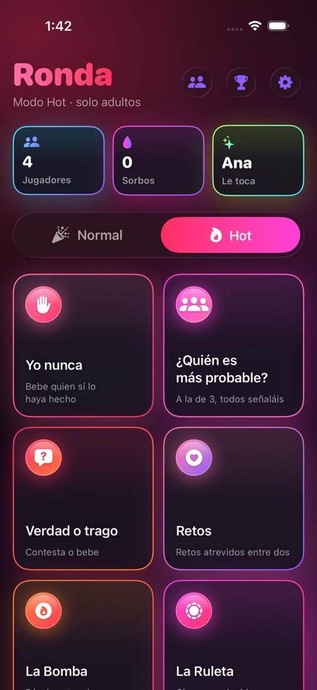
  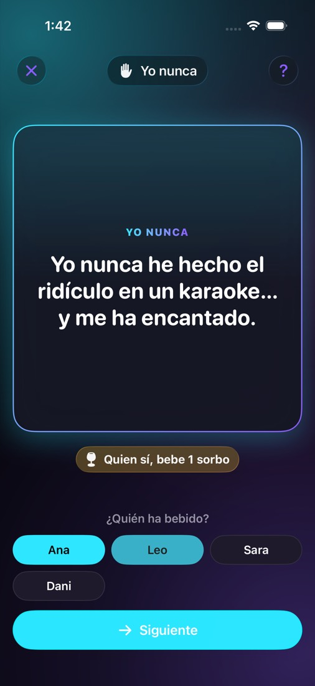
  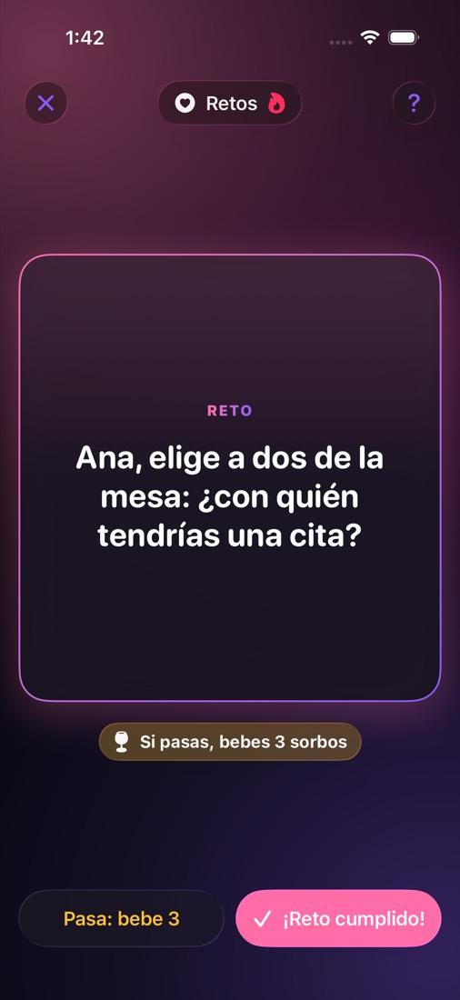

  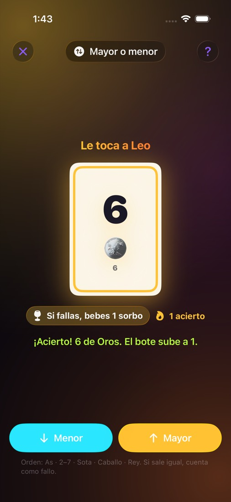
  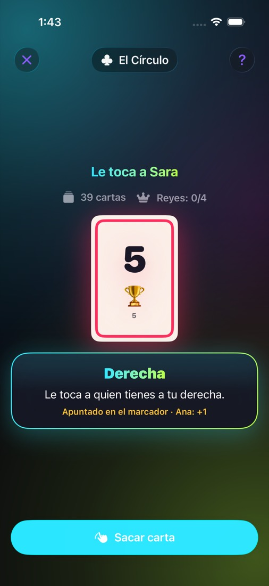
  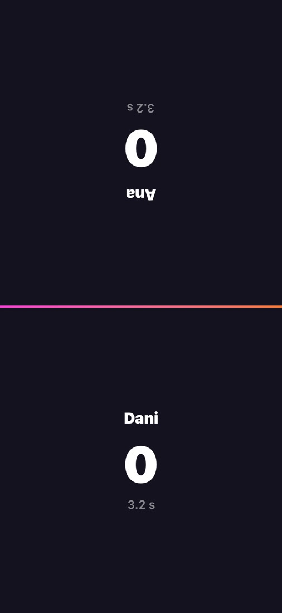
  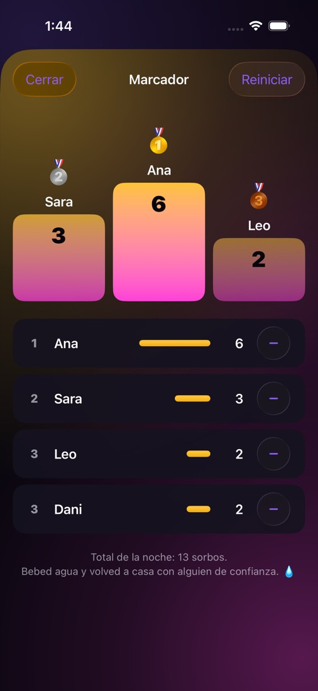

  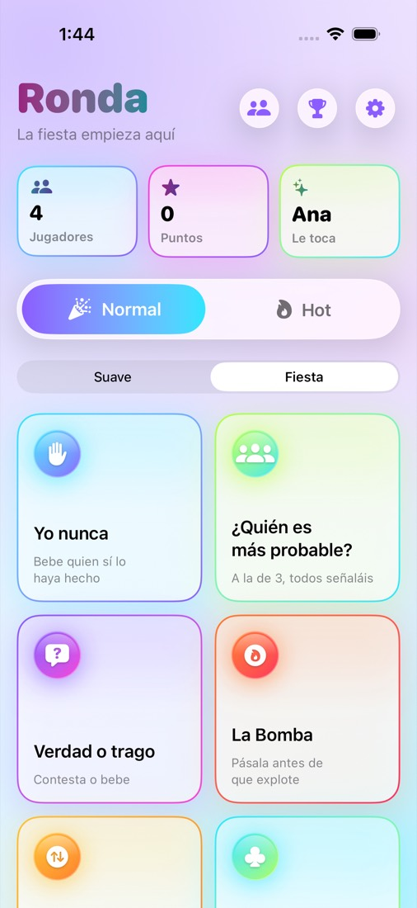
  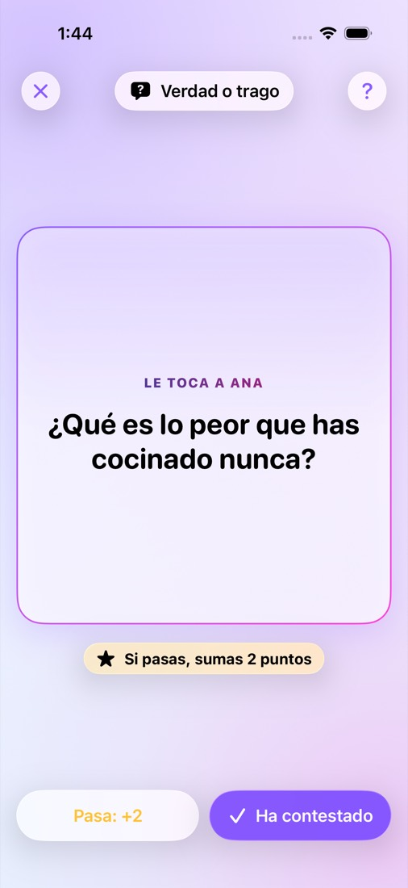

Modo oscuro por defecto; modo claro o automático en Ajustes → Apariencia.

Capturas reales del simulador (iPhone 17 Pro, iOS 26.5), generadas por los tests de interfaz.

## Dos apartados

**Normal** (niveles Suave y Fiesta)

| Juego | Cómo funciona |
|---|---|
| Yo nunca | Sale una frase; bebe quien sí lo haya hecho. Marcas en la app quién ha bebido. |
| ¿Quién es más probable? | Cuenta atrás de 3 y todos señaláis. El más señalado bebe 2 (con empate, todos los empatados). |
| Verdad o trago | Le toca a quien sale en pantalla: contesta o bebe. |
| La Bomba | Categoría y a pasar el móvil: hace tic-tac cada vez más rápido y explota en un momento al azar. |
| Mayor o menor | Baraja española de 40 cartas. Cada acierto sube el bote; si fallas o hay empate, te lo bebes. Con 3 aciertos puedes plantarte y pasar el bote. |
| El Círculo | Cada carta de la baraja tiene una norma. Quien saque el cuarto Rey se lleva el castigo final. |
| Duelos | Dos jugadores cara a cara, cada uno en su mitad de la pantalla: Reflejos, Toques o Colores. |
| La Ruleta | Ruleta con pesos: «bebe tu izquierda», «todos», «reparte 3», «te libras»… |

**Hot 🔥** (solo para mayores de edad y con el acuerdo de todo el grupo)
Yo nunca, ¿Quién es más probable?, Verdad o trago, **Retos** (retos atrevidos entre dos jugadores),
La Bomba, La Ruleta y El Círculo, todos con contenido picante propio. Sugerente, nunca explícito,
y **siempre se puede pasar** bebiendo.

## Para toda la noche
- **Marcador** de sorbos por jugador con podio y reinicio. La app apunta sola lo que puede saber
  (quién falla en Mayor o menor, quién pierde un duelo, las normas del Círculo y la Ruleta…).
- **Orden en la mesa:** los jugadores se apuntan en el orden en que estáis sentados, así funcionan «izquierda» y «derecha».
- **Mis cartas:** añade tus propias cartas a Yo nunca, ¿Quién es más probable?, Verdad o trago y Retos.
- **Responsable:** confirmación de edad, rondas de agua (cada 5, 10 o 15 cartas), siempre en sorbos y un
  **modo sin alcohol** en el que los sorbos se convierten en puntos. Si eres menor, la app solo funciona
  en modo sin alcohol y el apartado Hot queda bloqueado.

## Tecnología
SwiftUI (iOS 26, Liquid Glass), SwiftData (cartas propias), Observation, vibraciones con UIKit feedback.
Swift 6 con concurrencia estricta. La lógica de los juegos (barajas, Mayor o menor, Círculo, bomba,
duelos, ruleta con pesos, marcador) está separada de la interfaz y tiene tests.

La app es solo en modo oscuro a propósito: se juega de noche y una pantalla blanca en mitad de la mesa
rompería el ambiente.

## Tests
| Suite | Qué cubre |
|---|---|
| `RondaTests` | Barajas sin repetición, nombres y orden en la mesa, marcador con empates, rondas de agua, textos con jugadores, modo sin alcohol, Mayor o menor, El Círculo (el cuarto Rey), mecha de la bomba, duelos, ruleta (cae donde debe y respeta los pesos), contenido suficiente y sin duplicados, cartas propias y persistencia de la sesión. |
| `RondaUITests` | Primer arranque (edad), los 8 juegos del apartado Normal con el marcador, el apartado Hot con el consentimiento, los ajustes con el modo sin alcohol y la lista de jugadores. |

## Ejecutar
Abre `Ronda.xcodeproj`, elige tu equipo y un *Bundle Identifier* propio en *Signing & Capabilities* y pulsa ⌘R.
