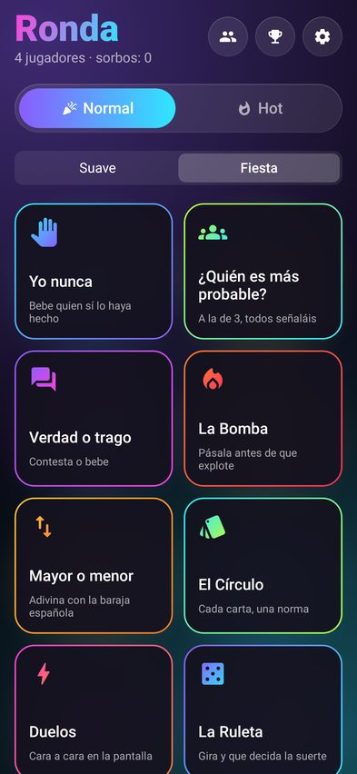
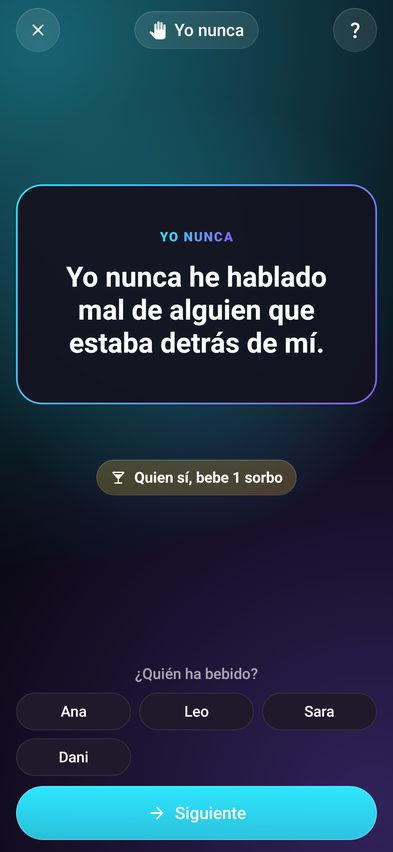
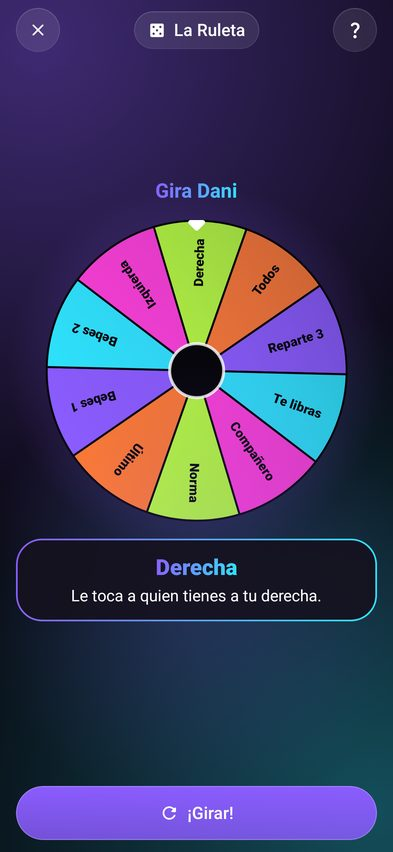
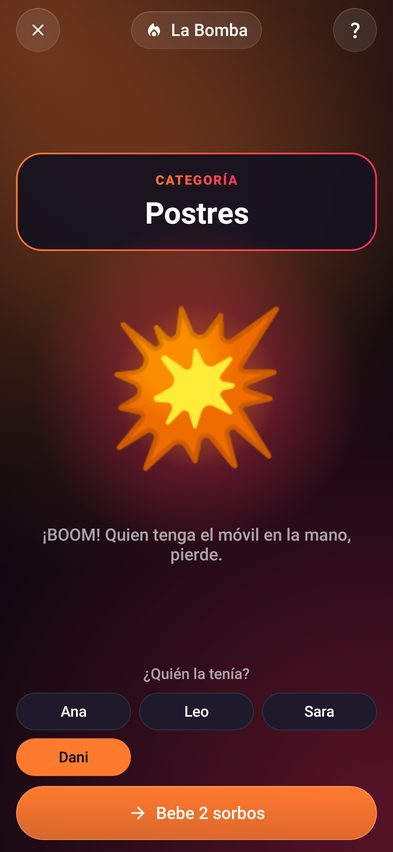
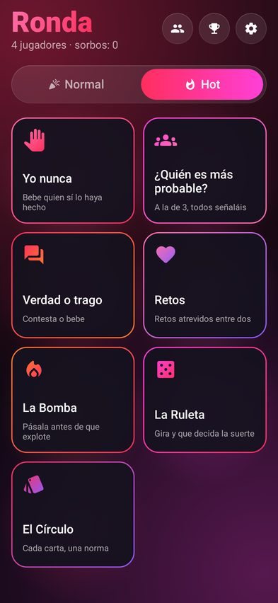
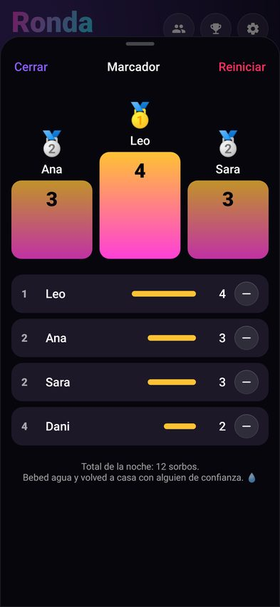

# Ronda para Android

La misma app de juegos para la previa que [Ronda para iPhone](../Ronda/README.md), hecha para Android con
Kotlin y Jetpack Compose. Tiene los mismos juegos, las mismas ~400 cartas y los apartados Normal y Hot.

| Inicio | Yo nunca | La Ruleta | La Bomba | Hot | Marcador |
|---|---|---|---|---|---|
|  |  |  |  |  |  |

## Instalar el APK en el móvil
1. Descarga `app-release.apk` (te lo paso yo, o desde los *artifacts* de la acción **Android CI** en GitHub).
2. Ábrelo en el móvil. Android te pedirá permitir "instalar apps de origen desconocido" para la app con la
   que lo abras (Chrome, Archivos…). Acepta y pulsa **Instalar**.
3. Las versiones nuevas se instalan encima y conservan jugadores, marcador y cartas.

Funciona en Android 8.0 o posterior.

## Qué incluye
- **Normal**: Yo nunca, ¿Quién es más probable?, Verdad o trago, La Bomba, Mayor o menor, El Círculo,
  Duelos y La Ruleta, con nivel Suave o Fiesta.
- **Hot** (solo mayores de edad y con el consentimiento de todo el grupo): Yo nunca, ¿Quién es más probable?,
  Verdad o trago, Retos, La Bomba, La Ruleta y El Círculo.
- Marcador con podio y botón −1 para corregir, rondas de agua, modo sin alcohol, cartas propias y vibraciones.
- **120 Hz**: la app pide a la pantalla su frecuencia más alta (90/120 Hz en los móviles que la tienen). Las
  animaciones están pensadas para ir fluidas: degradados en lugar de desenfoques y la ruleta dibujada una
  sola vez y girada por la GPU.

## Proyecto
- `app/src/main/java/app/ronda/party/core`: motores de juego (sin dependencias de Android).
- `content/CardBank.kt`: las cartas, convertidas automáticamente del archivo de iOS para que sean idénticas.
- `session/PartySession.kt`: estado de la noche, guardado en el móvil.
- `ui/`: pantallas y juegos en Compose.
- Tests: `./gradlew testDebugUnitTest` ejecuta 34 tests del motor y 4 recorridos completos por la interfaz
  (Robolectric) que guardan una captura de cada pantalla en `app/build/screenshots`.
- APK: `./gradlew assembleRelease` → `app/build/outputs/apk/release/app-release.apk`.

El APK se firma con `app/sideload.keystore`, una clave pública a propósito (como la clave de depuración de
Android) para que cada versión se instale encima de la anterior. Para publicar en Google Play hace falta
crear una clave privada propia y no subirla al repositorio.
